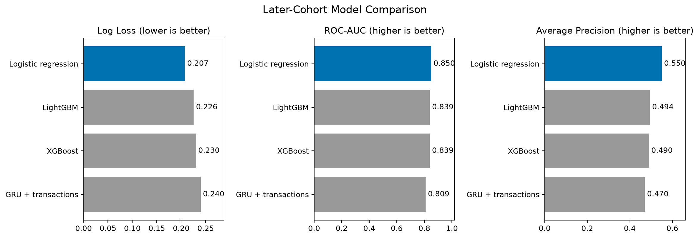
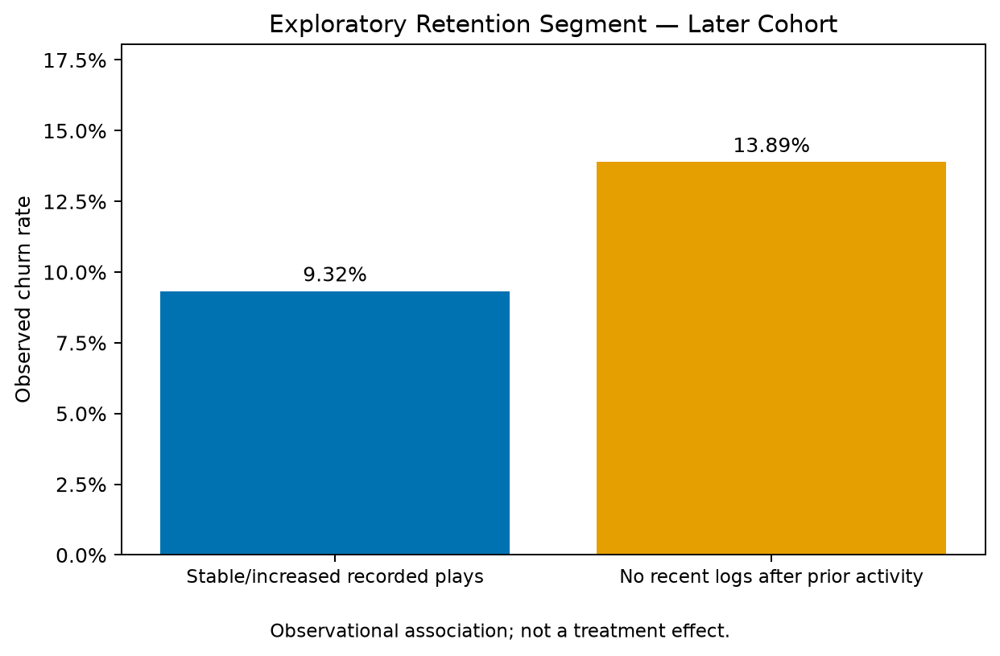

# KKBOX Customer Churn Prediction

A portfolio project combining large-scale data auditing, SQL feature engineering, churn modeling, retention experiment design, and a PyTorch GRU benchmark.

## Highlights

- Audited **21.5M original transaction records** and **392.1M listening activity records** using SQL and Python.
- Extracted **24.0M daily activity records** and built **23 transaction and listening features**.
- Compared Logistic Regression, XGBoost, LightGBM, and a GRU using historical training data and a later evaluation cohort.
- Designed a randomized retention experiment with power analysis; no experiment was run.

## Model Results

Historical training contains 882,127 users; later evaluation contains 970,960 users. Training outcomes are observed before the later feature cutoff.

| Model | Log Loss ↓ | ROC-AUC ↑ | Average Precision ↑ |
|---|---:|---:|---:|
| Logistic Regression | **0.2073** | **0.8499** | **0.5501** |
| LightGBM | 0.2255 | 0.8395 | 0.4941 |
| XGBoost | 0.2300 | 0.8392 | 0.4896 |
| GRU + transaction inputs | 0.2398 | 0.8091 | 0.4702 |



Logistic Regression was the strongest benchmark in this evaluation. Adding listening features reduced its Log Loss by **2.64%**. Historical internal hyperparameter tuning did not improve the tree models' later-period results.

The GRU uses 30-day listening sequences and transaction inputs. Its epoch count was selected using historical internal validation, followed by refitting on all historical users. It did not outperform the classical baselines.

[Feature comparison](reports/behavior_feature_comparison.csv) · [Tuning results](reports/tuning_comparison.csv) · [GRU configuration](reports/gru_training_config.json)

## Risk Targeting and Retention Insight

The combined-feature Logistic Regression's highest-risk 10% of users achieved:

- **53.50% Precision@10%**
- **59.49% Recall@10%**
- **5.95 Lift@10%**

Previously active users with no logs in the most recent seven days had **13.89% churn**, compared with **9.32%** among the established-activity reference group with stable or increased recorded plays.



The target requires at least four recorded days and 20 recorded plays in the preceding seven-day window. The later cohort contains 5,041 such users.

This association motivates testing personalized recommendations or re-engagement reminders after verifying logging, subscription, and contact eligibility. It does not establish a causal retention effect.

[Segment analysis](notebooks/13_retention_segments.ipynb) · [Risk targeting results](reports/risk_targeting_results.csv)

## Proposed Randomized Experiment

The user-level 1:1 design specifies intention-to-treat analysis and a fixed renewal observation endpoint.

Using a historical baseline of 13.89%, a **2-percentage-point absolute reduction**, two-sided α=0.05, and 80% power requires approximately **4,400 users per arm**, or **8,800 total**.

The historical candidate pool is insufficient for this planning target and has not undergone prospective eligibility checks. No intervention was delivered.

[Experiment plan](reports/retention_experiment_plan.md) · [Power analysis](reports/retention_power_analysis.csv)

## Data and Evaluation Design

Source: [WSDM — KKBOX's Churn Prediction Challenge](https://www.kaggle.com/competitions/kkbox-churn-prediction-challenge/data).

Original transactions and listening logs cover January 2015 through February 2017. Full files were scanned for auditing; only relevant users and windows were extracted for modeling.

| Cohort | Feature cutoff | Transaction window | Listening window |
|---|---|---|---|
| Historical training | 2016-11-30 | 90 days | 30 days |
| Later evaluation | 2017-02-28 | 90 days | 30 days |

Historical December 2016 labels were reconstructed using the provided labeling example, with outcomes observed through January 30, 2017. A renewal gap of at least 30 days, or no observed renewal, is classified as churn. Later evaluation uses the supplied `train_v2` labels.

Raw data, user-level derived files, and model weights are excluded from Git.

## Reproduce

Use Python 3.11 and install the recorded dependencies:

```bash
python -m pip install -r requirements.txt
jupyter lab
```

Obtain the official data and follow [the reproduction guide](docs/reproduction.md). Notebooks are organized in numbered stages; reports can be inspected without downloading raw data.

## Limitations

- Historical reconstructed labels and official later labels have different provenance; exact label parity and official generation parameters were not independently verified.
- Point-in-time source snapshots were not verified. This is retrospective cohort evaluation, not a verified deployment simulation.
- The later cohort was inspected repeatedly and is not an untouched independent test.
- GRU and classical models use different representations, so the comparison does not isolate architecture or sequence-order effects.
- Predictive lift and segment differences do not measure intervention effectiveness.

## Repository

- `notebooks/`: numbered analysis, modeling, and experiment-design stages
- `sql/`: queries used by the notebooks
- `reports/`: aggregate results, configurations, figures, and experiment plan
- `docs/`: reproduction instructions
- `requirements.txt`: recorded Python dependencies