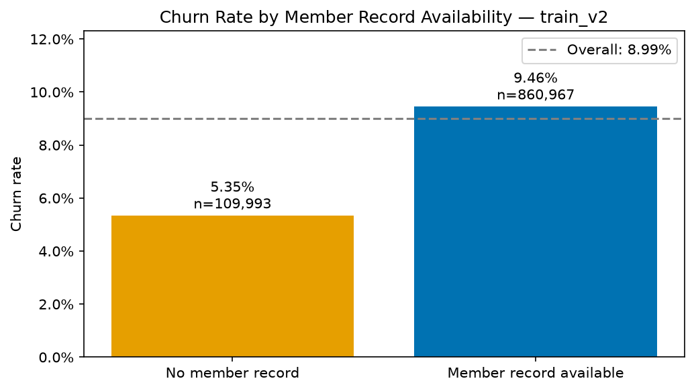

# KKBOX Customer Churn Prediction

An ongoing portfolio project exploring customer churn through SQL, Python, predictive modeling, and retention experiment design.

## Current Progress

Completed an initial audit of the churn labels and member data. Modeling and experiment design are planned.

### Initial Findings

- `train.csv`: 992,931 users; 6.39% churn.
- `train_v2.csv`: 970,960 users; 8.99% churn.
- Both label tables have unique user IDs and no missing or invalid labels.
- 11.33% of `train_v2` users have no matching member record.
- Churn is 5.35% among unmatched users and 9.46% among matched users. This is a descriptive association, not a causal finding.
- All labeled users are retained. Unusable ages are treated as missing, and missing gender values are represented as `unknown`.



## Transaction Data Audit

Audited both transaction files for date coverage, cross-version overlap, exact duplicate rows in v2, and numeric and binary field validity.

### Findings

- `transactions.csv` contains 21,547,746 rows, with transaction dates from January 2015 through February 2017.
- `transactions_v2.csv` contains 1,431,009 rows: 361,187 historical rows before March 2017 and 1,069,822 March 2017 rows.
- None of the historical v2 rows matches a v1 row across all nine fields.
- Of the historical v2 rows, 9,967 match a v1 user and transaction date; 6,126 match all fields except the membership expiration date.
- No exact duplicate rows were found within v2. Exact duplicates within v1 have not yet been audited.
- Both files contain no missing or unparseable plan durations or amounts, no negative plan durations or amounts, and no invalid auto-renewal or cancellation flags.
- Zero-payment and zero-duration records are retained pending further investigation.
- Expiration dates include values such as January 1, 1970 and October 15, 2036, which require further investigation.

### Processing Decisions

The files will not be concatenated or overwritten based solely on user ID and transaction date. These fields do not uniquely identify a transaction.

Initial feature development will use `transactions.csv` alone. A January 31, 2017 cutoff, taken from the official labeling example, is a provisional configuration. Its alignment with the supplied label files must be verified before model evaluation.

See [the transaction audit notebook](notebooks/02_transaction_audit.ipynb) for the queries and detailed results.

## Data

Source: [WSDM — KKBOX's Churn Prediction Challenge](https://www.kaggle.com/competitions/kkbox-churn-prediction-challenge/data).

Obtain the data according to the competition rules and extract these files into `data/raw/`:

- `train.csv`
- `train_v2.csv`
- `members_v3.csv`

Raw data is excluded from this repository.

## Run the Data Audit

Use Python 3.11. From the repository root:

```bash
python -m pip install -r requirements.txt
jupyter lab
```

Open `notebooks/01_data_audit.ipynb` and run the cells in order.

## Repository Structure

- `notebooks/`: data audit and analysis
- `sql/`: SQL queries used in the analysis
- `reports/`: aggregate audit results and figures
- `requirements.txt`: Python dependencies

## Next Steps

Verify label periods and feature cutoffs, audit transaction and listening data, and build baseline models before evaluating more complex approaches.
