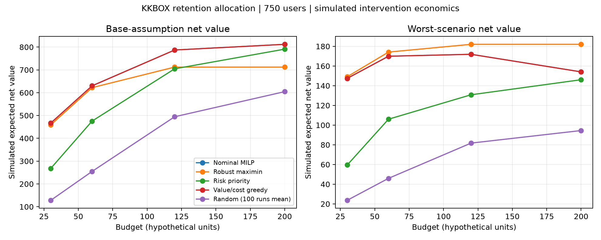

# Retention allocation with Pyomo and Gurobi

## Purpose and scope

A completed portfolio prototype connecting historical-trained churn predictions to budget-constrained retention decisions. It demonstrates algebraic modeling, mixed-integer optimization, feasible heuristic benchmarks, budget sensitivity, and scenario-based robustness. It does not demonstrate a real campaign, causal uplift estimation, or multistage stochastic programming.

## Observed data versus assumed inputs

- Real data: KKBOX historical and later combined feature tables, user identifiers, and observed training/evaluation labels.
- Prediction: fixed combined-feature logistic regression from Notebook 12, refitted on 882,127 historical users. Later-cohort Log Loss is 0.207310 and ROC-AUC is 0.849893, reproducing the recorded benchmark. Labels are used for training and prediction evaluation only, never for retention allocation inputs or sample selection.
- Optimization sample: 750 later-cohort users ordered by identifier MD5 hash, then identifier. This deterministic sample is independent of outcomes, but its representativeness has not been established. It keeps the model within the free size-limited Gurobi license (1,500 binary variables).
- Simulated inputs: retained contribution margin, action-specific response, action costs, channel capacities, budgets, and operational eligibility. No true margin or intervention effects are available in the source tables.
- Predicted baseline risk is not an estimated treatment effect. The simulated uplift equals predicted risk times an assumed relative risk reduction. The reduction varies by observed activity/auto-renewal features and seeded simulation jitter. This modeling choice is illustrative, not empirically justified.
- Discounts are modeled as a fixed cost paid for each targeted user regardless of response; this is an assumption, not an observed billing mechanism. No-contact has zero incremental value and zero cost.

All assumptions and versions are recorded in `reports/optimization/config.json`. The original experiment's 2-percentage-point planning target is not reused as a measured effect.

## Mathematical model

For user i and action a, x[i,a] is binary. Both variables zero means no intervention.

Nominal objective: maximize sum(x[i,a] * (margin[i] * uplift[i,a] - cost[a])).

Constraints:

1. At most one intervention per user.
2. Total cost at or below the budget.
3. At most 150 reminders and 60 discounts.

Budgets are 30, 60, 120, and 200 hypothetical monetary units. Scenarios multiply reminder/discount uplifts by (0.4,0.3), (1,1), or (1.4,1.5). Uplifts remain bounded by baseline churn risk.

The robust formulation maximizes the minimum scenario net value using an auxiliary floor variable and one constraint per scenario. Decisions are made once, before observing the scenario. No scenario probabilities, recourse decisions, scenario tree, or decomposition algorithm are implemented. This is single-stage maximin robust optimization.

## Comparisons and validation

- Risk priority: descending predicted churn probability; prefer each user's highest positive base-value action, then try lower-cost options if necessary.
- Marginal value/cost greedy: repeatedly choose the best feasible gain per additional cost, allowing reminder-to-discount upgrades.
- Random: mean of 100 seeded permutations of positive-base-value user/action pairs. This is a randomized allocation heuristic, not a randomized experiment.
- Nominal and robust models: solved through Pyomo's direct Gurobi interface with zero requested relative MIP gap. All eight runs terminated as optimal; the largest absolute bound gap was 0.00000000.

All methods share the same inputs, budget, one-action rule, and capacities. Enumeration on an independent three-user problem validates both objective formulations. Assertions also check every allocation's feasibility, nominal dominance over feasible baselines, robust worst-scenario dominance over nominal decisions, and nondecreasing optima as budgets increase.

## Results at budget 120

| Strategy | Spend | Base net value | Weak-scenario net value |
|---|---:|---:|---:|
| nominal_milp | 120.00 | 787.16 | 171.94 |
| value_per_cost | 120.00 | 787.16 | 171.94 |
| risk_priority | 120.00 | 704.78 | 130.83 |
| random | 120.00 | 494.49 | 81.74 |
| robust_maximin | 86.00 | 712.32 | 182.06 |

The nominal MILP's simulated base net value is 11.7% higher than risk priority. The upgrade-aware greedy strategy reaches the same objective in this instance; no improvement over that stronger heuristic is claimed. Random's base net value has across-run standard deviation 37.60.

Robust allocation increases the weakest modeled scenario's value by 5.9% relative to the nominal allocation while lowering base-scenario value and spending only 86 units. The entire budget need not be spent when additional actions have negative worst-case marginal value. These are simulated expected values, not observed churn reductions, actual profits, or general performance guarantees. Shared weak/base/strong multipliers are a narrow stress test rather than a comprehensive uncertainty model.



## Reproduction

Activate the existing `kkbox-churn` environment and run from the repository root. The required historical/later feature tables and feature configuration must already exist.

```bash
python -m pip install --target .optimization-deps -r requirements-optimization.txt
python scripts/retention_optimization.py
```

Pyomo/Gurobi have already been installed in the ignored project-local `.optimization-deps` directory. The script checks that directory automatically. User-level inputs and assignments remain in ignored `data/processed/retention_optimization/`; the refitted model remains in ignored `models/`. Aggregate reports, assumptions, and the results notebook are suitable for Git.

Open `notebooks/18_retention_optimization_results.ipynb` to review the completed results without refitting. To reproduce the full workflow, use the script above. The sample is intentionally small; do not claim full-cohort optimization or production deployment.

## Suggested resume bullet

Built a Pyomo/Gurobi mixed-integer optimization prototype combining KKBOX churn predictions with simulated intervention effects to allocate retention budgets; benchmarked three targeting heuristics and evaluated budget sensitivity and scenario-based robustness.

Optional quantified version:

Developed a Pyomo/Gurobi retention allocation prototype for 750 KKBOX users, achieving 11.7% higher simulated expected net value than risk-priority targeting at a fixed budget; evaluated four budgets and three intervention-effect scenarios.

Use one bullet, replacing a less relevant KKBOX bullet rather than expanding the CV indefinitely. Add Pyomo and Gurobi to programming/tools only if comfortable discussing the model assumptions and tradeoffs. Do not list multistage stochastic programming, clinical portfolio optimization, or causal uplift estimation as completed experience.

## Official references

- [Gurobi free size-limited license](https://support.gurobi.com/hc/en-us/articles/29682074018833-What-does-Restricted-license-for-non-production-use-only-mean)
- [Pyomo direct Gurobi interface](https://pyomo.readthedocs.io/en/stable/_modules/pyomo/solvers/plugins/solvers/gurobi_direct.html)
